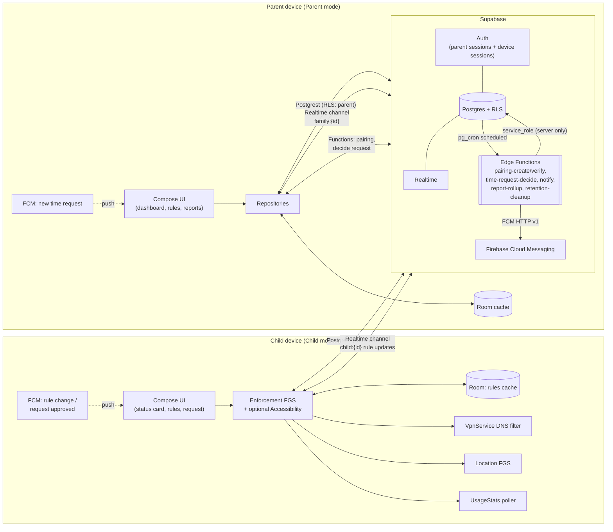

# FamilyGuard — Parental Control for Android (Supabase backend)

**PHASE 1 — PLAN + MILESTONE IMPLEMENTATION**
Status: **M1 done** — multi-module Compose app builds (`./gradlew :app:assembleDebug`), Supabase
migrations + RLS tests are committed and green (local Postgres harness passes; CI runs
`supabase test db`), and sign-in / sign-up / confirmation / sign-out are implemented with unit tests.

---

## 1. Assumptions and open questions

### 1.1 Assumptions I am making

| # | Assumption |
|---|---|
| A1 | One app, two modes (Parent / Child), selected at first launch and switchable only behind a parent PIN in parent mode. Child mode is entered once during pairing and cannot be exited by the child. |
| A2 | Min SDK 26 (Android 8.0), target/compile = latest stable SDK (35/36). Everything from API 26 up must degrade gracefully. |
| A3 | Distribution through Google Play (public track), so every permission must survive Play Console declaration review. |
| A4 | Web filtering is done on-device with a local `VpnService` DNS filter (no traffic leaves the device; no remote proxy). |
| A5 | Child devices never hold parent credentials. They hold their own Supabase session created at pairing time. |
| A6 | Anonymous/offline use is allowed: the child app enforces cached rules with no internet, syncs later. |
| A7 | Data retention: location 30 days, raw usage events 90 days, daily aggregates 400 days, audit log 400 days, pairing codes 24 h. |
| A8 | English-only strings initially, but all user-facing text lives in `strings.xml` from day one. |
| A9 | Currency of features is MVP: app blocking, schedules, reports, web filter, location, pairing, time requests, PIN, offline enforcement. No keylogging, no message/call interception, no stealth. |
| A10 | Supabase Free plan is acceptable for development and early production, with the documented quotas in §11.3. |

### 1.2 Five questions (defaults in **bold** if unanswered)

**Q1 — Where will the app ship?** Google Play public track, or sideload/an enterprise channel only?
**Default: Google Play public track.** This decides how aggressive we can be: `QUERY_ALL_PACKAGES`, background location, VPN and accessibility declarations all have to be approved. If the answer is sideload/enterprise, several months of review risk disappear and we can use the AccessibilityService path more freely.

**Q2 — Web filtering approach?** (a) local `VpnService` DNS filter with our own blocklists, or (b) hand DNS to a family-safe resolver (CleanBrowsing / Cloudflare 1.1.1.3 Kids / Google OpenDNS Family) through the same VPN, or (c) both — safe resolver as base plus local domain overrides.
**Default: (c) both** — safe resolver underneath, local block/allow list on top. Best coverage for least code, and it keeps us from becoming a "traffic inspection" app.

**Q3 — How many parents and children per family?** Single parent + single child, or multi-parent / multi-child with shared access?
**Default: multi-parent and multi-child** (schema is designed for it; nothing about it costs extra now, adding it later is a migration).

**Q4 — Does the child device need its own Google account or Supabase login?**
**Default: no.** Pairing creates a device-scoped Supabase session (anonymous sign-in upgraded by an Edge Function). The child never types a password.

**Q5 — Is the child's phone a supervised/family-linked device (Google Family Link) or a plain personal device?**
**Default: plain personal device**, with the honest-app model: the app is visible, the child can see the rules, and uninstall is *possible* but reported to the parent. If supervised mode is available we can layer `DevicePolicyController` on top for stronger enforcement.

---

## 2. Tech stack decision

| Layer | Choice | Why |
|---|---|---|
| Language | **Kotlin** (first-party, KMP-ready) | Coroutines/Flow, Compose interop, single language across app and (later) shared models. |
| UI | **Jetpack Compose + Material 3** | Required by brief; M3 gives dark mode, dynamic color and accessible components for free. |
| Architecture | **MVVM + Clean Architecture (multi-module)** | Presentation / domain / data separation lets parent and child features share data layers while shipping separate UI flows; makes RLS and repository testing tractable. |
| DI | **Hilt** | Compile-time validated graph, first-party WorkManager/Compose integration; Koin is looser and easier to misuse in a large module graph. |
| Async | **Coroutines + Flow** | Native fit for Realtime subscriptions (`.callbackFlow`), Room `Flow` and one-shot RPCs. |
| Local DB | **Room** | Required for offline rule enforcement; relational schema mirrors the Supabase schema, so sync mapping is trivial; supports `Flow` observation for the enforcement service. |
| Background | **WorkManager** (periodic usage upload, report refresh) **+ Foreground Services** (enforcement, location) | WorkManager survives reboot and Doze for *deferrable* work; enforcement and location must be a foreground service because they are immediate and must not be killed. |
| Networking | **supabase-kt** (`auth-kt`, `postgrest-kt`, `realtime-kt`, `functions-kt`) on **Ktor CIO** | The brief mandates it. Current stable is **3.8.0**; use the BOM (`io.github.jan-tennert.supabase:bom`) to align modules. Ktor engine must support WebSockets for Realtime. |
| Session storage | supabase-kt default session manager + **DataStore-backed custom `SessionManager`** | `autoLoadFromStorage = true` is default; a custom `SessionManager` backed by DataStore + Android Keystore gives encrypted-at-rest tokens (§7). |
| Push | **FCM** via `firebase-messaging`, triggered from Edge Functions | Supabase has no mobile push; FCM is transport only, payload carries only `type`, `child_id`, `request_id` — no sensitive content. |
| Local notifications / PIN | **BiometricPrompt** + Android Keystore | Biometric for parent mode unlock; PIN fallback stored only as a salted hash (see §7.5). |
| Charts | **Vico** (Compose-native) or hand-rolled Canvas | Lightweight, no WebView, dark-mode aware. Decision finalised at M9. |
| QR | **ZXing Embedded** (`journeyapps`) | Battle-tested QR generation for pairing; decoding uses CameraX + `ImageAnalysis`. |
| CameraX | **CameraX 1.4+** | Pairing QR scan + optional avatar capture. |
| Tests | **JUnit5? No — JUnit4 + Turbine + MockK + Robolectric + androidx.test + pgTAP** | JUnit4 is still the Android instrumented standard; Turbine for Flow, pgTAP for RLS SQL tests. |
| Backend | **Supabase**: Postgres + RLS, Auth, Realtime, Edge Functions (Deno/TS), optional Storage | As specified. |
| Build secrets | `local.properties` → `BuildConfig.SUPABASE_URL` / `SUPABASE_ANON_KEY` | Anon key is public-by-design but never committed; `service_role` exists **only** in Edge Function secrets. |

---

## 3. System architecture

### 3.1 One app with two modes, or two apps?

**Decision: ONE app, two modes.** Justification:

1. **Play review**: two apps doubling every sensitive permission declaration doubles the review surface and the rejection risk. One bundle, one declaration set.
2. **Policy honesty**: Play requires monitoring apps to declare `isMonitoringTool=child_monitoring`, show a persistent notification and a distinct icon. That is satisfied by a mode flag inside one app, and it is *more* transparent — the child sees the same app the parent installed.
3. **Maintenance**: one module graph, one version, one CI pipeline, one privacy policy.
4. **Safety**: there is no way to accidentally ship a "child" build that lacks the visible indicator, because the indicator lives in the shared core.

Mode is chosen at first launch: **Parent** completes onboarding → creates/joins family. **Child** is only reachable through a pairing QR/code, after which the launcher icon stays, the persistent notification stays, and the mode can only be changed by entering the parent PIN (or by wiping the device).

Trade-off accepted: a single APK means the child device carries parent-mode code. Mitigation: parent-mode entry is protected by PIN/biometric and the child-mode session has no permissions to read family data (RLS enforces it server-side — §4.3), so even decompiling the APK yields nothing.

### 3.2 Module graph

```
:app                       // Hilt root, navigation graph, mode routing, Firebase init
:core:common               // Result wrappers, dispatchers, time, logging
:core:network              // supabase-kt client, key/BuildConfig wiring, retry
:core:data                 // Repositories + sync engine (remote <-> Room)
:core:database             // Room DB, DAOs, entities, migrations
:core:domain               // Use cases, models (pure Kotlin, unit-testable)
:core:auth                 // Session management, parent PIN/biometric gate
:core:permissions          // Permission walkthrough framework, status tracking
:feature:onboarding
:feature:pairing           // parent QR display / child QR scan + code entry
:feature:family            // family + child management
:feature:rules             // app limits, schedules, web filters editors
:feature:reports           // charts, per-app breakdown
:feature:location           // map + child status
:feature:requests          // time-extension requests (parent + child)
:feature:settings           // PIN, retention, about, privacy links
:feature:childhub           // child-mode home: status card, rules list, request button
:feature:enforcement       // block screen, overlay, VPN notification UI
:service:enforcement        // foreground service, Accessibility (optional), overlay host
:service:usage              // UsageStats polling, batching
:service:location           // location foreground service
```

Optional at MVP: collapse `:feature:*` into fewer modules if build time hurts; the boundaries above are the plan of record.

### 3.3 Data flow diagram



**Rule path (fast, offline-first):** parent edits rule → Postgres + RLS → Realtime postgres_changes insert/update → child app receives event → writes Room in the same transaction shape → enforcement service observes Room `Flow` → applies within seconds. FCM is only a *wake-up nudge* (Realtime sockets are dropped in Doze). If there is no internet, the child keeps enforcing the last known rules from Room; on reconnect a full delta sync (`updated_at > last_sync_at`) reconciles.

**Time-request path:** child taps "More time" → insert `time_requests` (RLS: device) → Realtime broadcast on `family:{id}` → Edge Function `notify` via DB webhook → FCM to parent → parent approves in-app or from the notification → `time-request-decide` Edge Function validates and updates row → Realtime on `child:{id}` + FCM to child → child app extends the local deadline in Room.

---

## 4. Supabase design

All SQL in this section is delivered as migration files under `supabase/migrations/<timestamp>_*.sql` in Phase 2.

### 4.1 Entity-relationship overview

```
auth.users 1-1 profiles
profiles M-N families (through family_members)
families 1-N children
children 1-N devices          devices N-1 auth.users (device session user)
families 1-N pairing_codes
children 1-N rules / app_limits / schedules / web_filters
children 1-N usage_events / locations / time_requests / usage_daily
families 1-N audit_log
```

### 4.2 Schema

```sql
-- 0001_init.sql
create extension if not exists "pgcrypto";
create extension if not exists "pg_cron";   -- hosted Supabase: enabled in dashboard

-- Helper: current timestamp, immutable
create or replace function public.now_utc() returns timestamptz
language sql stable as $$ select now() $$;

-- ============ PROFILES ============
create table public.profiles (
  id            uuid primary key references auth.users(id) on delete cascade,
  display_name  text not null check (char_length(display_name) between 1 and 60),
  avatar_url    text,
  locale        text not null default 'en',
  created_at    timestamptz not null default now(),
  updated_at    timestamptz not null default now()
);

-- ============ FAMILIES ============
create table public.families (
  id          uuid primary key default gen_random_uuid(),
  name        text not null check (char_length(name) between 1 and 60),
  created_by  uuid not null references public.profiles(id) on delete restrict,
  created_at  timestamptz not null default now(),
  updated_at  timestamptz not null default now()
);

-- ============ FAMILY MEMBERS (extra table; see note) ============
create table public.family_members (
  family_id  uuid not null references public.families(id) on delete cascade,
  profile_id uuid not null references public.profiles(id) on delete cascade,
  role       text not null check (role in ('parent','guardian')),
  added_by   uuid references public.profiles(id),
  created_at timestamptz not null default now(),
  primary key (family_id, profile_id)
);
-- NOTE: family_members IS a RLS-enabled table (see 4.3.6). No table in this
-- design is created without RLS. Every table added in any migration must ship
-- with `alter table ... enable row level security;` in the same file.

-- ============ CHILDREN ============
create table public.children (
  id          uuid primary key default gen_random_uuid(),
  family_id   uuid not null references public.families(id) on delete cascade,
  display_name text not null check (char_length(display_name) between 1 and 60),
  birth_date  date,
  avatar_url  text,
  timezone    text not null default 'UTC',
  created_at  timestamptz not null default now(),
  updated_at  timestamptz not null default now()
);
create index children_family_idx on public.children(family_id);

-- ============ DEVICES ============
create table public.devices (
  id            uuid primary key default gen_random_uuid(),
  child_id      uuid not null references public.children(id) on delete cascade,
  -- the Supabase auth user that this device logs in as (created by Edge Function)
  user_id       uuid unique references auth.users(id) on delete cascade,
  device_name   text not null,
  model         text,
  android_sdk   int,
  app_version   text,
  fcm_token     text,
  status        text not null default 'pending'
                check (status in ('pending','active','revoked')),
  paired_at     timestamptz,
  last_seen_at  timestamptz,
  created_at    timestamptz not null default now(),
  updated_at    timestamptz not null default now()
);
create index devices_child_idx  on public.devices(child_id);
create index devices_user_idx   on public.devices(user_id);
create index devices_fcm_idx    on public.devices(fcm_token) where fcm_token is not null;

-- ============ PAIRING CODES ============
create table public.pairing_codes (
  id          uuid primary key default gen_random_uuid(),
  family_id   uuid not null references public.families(id) on delete cascade,
  child_id    uuid references public.children(id) on delete cascade,
  code_hash   text not null,               -- sha256(normalised code + server salt)
  code_hint   text not null default 'XXXXXX', -- last 2 chars only, for parent UI
  created_by  uuid not null references public.profiles(id) on delete cascade,
  attempts    int  not null default 0,
  expires_at  timestamptz not null,
  used_at     timestamptz,
  created_at  timestamptz not null default now()
);
create index pairing_codes_hash_idx on public.pairing_codes(code_hash);
create index pairing_codes_expires_idx on public.pairing_codes(expires_at);
-- NOTE: no client ever reads code_hash. Written only by the
-- `pairing-create` Edge Function (service_role). RLS denies all client access.

-- ============ RULES (generic, versioned) ============
create table public.rules (
  id          uuid primary key default gen_random_uuid(),
  child_id    uuid not null references public.children(id) on delete cascade,
  kind        text not null check (kind in ('app_block','daily_total','block_on_schedule')),
  enabled     boolean not null default true,
  config      jsonb not null default '{}'::jsonb,
  starts_at   timestamptz,
  ends_at     timestamptz,
  version     int not null default 1,
  updated_by  uuid references public.profiles(id),
  created_at  timestamptz not null default now(),
  updated_at  timestamptz not null default now()
);
create index rules_child_idx on public.rules(child_id, updated_at desc);

-- ============ APP LIMITS ============
create table public.app_limits (
  id                 uuid primary key default gen_random_uuid(),
  child_id           uuid not null references public.children(id) on delete cascade,
  package_name       text not null,
  daily_limit_seconds int not null check (daily_limit_seconds between 60 and 86400),
  enabled            boolean not null default true,
  version            int not null default 1,
  updated_by         uuid references public.profiles(id),
  created_at         timestamptz not null default now(),
  updated_at         timestamptz not null default now(),
  unique (child_id, package_name)
);
create index app_limits_child_idx on public.app_limits(child_id);

-- ============ SCHEDULES ============
create table public.schedules (
  id          uuid primary key default gen_random_uuid(),
  child_id    uuid not null references public.children(id) on delete cascade,
  name        text not null,
  -- bit 0 = Sunday ... bit 6 = Saturday, integer 0..127
  days_mask   smallint not null default 127 check (days_mask between 0 and 127),
  start_time  time not null,     -- local time in children.timezone
  end_time    time not null,
  action      text not null default 'lock' check (action in ('lock','warn')),
  enabled     boolean not null default true,
  version     int not null default 1,
  updated_by  uuid references public.profiles(id),
  created_at  timestamptz not null default now(),
  updated_at  timestamptz not null default now(),
  check (start_time <> end_time)
);
create index schedules_child_idx on public.schedules(child_id);

-- ============ WEB FILTERS ============
create table public.web_filters (
  id          uuid primary key default gen_random_uuid(),
  child_id    uuid not null references public.children(id) on delete cascade,
  mode        text not null default 'blocklist' check (mode in ('blocklist','allowlist')),
  domains     text[] not null default '{}',
  categories  text[] not null default '{}',  -- resolved locally or by safe-DNS resolver
  resolver    text not null default 'safe_dns'
              check (resolver in ('safe_dns','local_blocklist')),
  enabled     boolean not null default true,
  version     int not null default 1,
  updated_by  uuid references public.profiles(id),
  created_at  timestamptz not null default now(),
  updated_at  timestamptz not null default now()
);
create index web_filters_child_idx on public.web_filters(child_id);

-- ============ USAGE EVENTS (raw, short retention) ============
create table public.usage_events (
  id           bigint generated always as identity primary key,
  child_id     uuid not null references public.children(id) on delete cascade,
  device_id    uuid not null references public.devices(id) on delete cascade,
  package_name text not null,
  event_type   text not null check (event_type in ('app_switch','screen_on','screen_off')),
  started_at   timestamptz not null,
  duration_sec int not null check (duration_sec between 0 and 86400),
  created_at   timestamptz not null default now(),
  -- idempotent batching: same batch retried after a network error cannot duplicate
  unique (device_id, package_name, started_at, event_type)
);
create index usage_events_child_time_idx on public.usage_events(child_id, started_at desc);
create index usage_events_day_idx on public.usage_events(child_id, date_trunc('day', started_at));

-- ============ USAGE DAILY (rollup for charts; extra table, RLS enabled) ============
create table public.usage_daily (
  child_id     uuid not null references public.children(id) on delete cascade,
  package_name text not null,
  day          date not null,
  seconds      bigint not null default 0,
  pickups      int not null default 0,
  updated_at   timestamptz not null default now(),
  primary key (child_id, package_name, day)
);
create index usage_daily_child_day_idx on public.usage_daily(child_id, day desc);

-- ============ LOCATIONS (30-day retention) ============
create table public.locations (
  id          bigint generated always as identity primary key,
  child_id    uuid not null references public.children(id) on delete cascade,
  device_id   uuid not null references public.devices(id) on delete cascade,
  lat         double precision not null check (lat between -90 and 90),
  lng         double precision not null check (lng between -180 and 180),
  accuracy_m  real check (accuracy_m >= 0),
  battery_pct smallint check (battery_pct between 0 and 100),
  recorded_at timestamptz not null,
  created_at  timestamptz not null default now()
);
create index locations_child_time_idx on public.locations(child_id, recorded_at desc);
create index locations_retention_idx  on public.locations(recorded_at);

-- ============ TIME REQUESTS ============
create table public.time_requests (
  id              uuid primary key default gen_random_uuid(),
  child_id        uuid not null references public.children(id) on delete cascade,
  device_id       uuid not null references public.devices(id) on delete cascade,
  package_name    text,                -- null = general screen-time extension
  requested_seconds int not null check (requested_seconds between 60 and 14400),
  reason          text check (char_length(reason) <= 200),
  status          text not null default 'pending'
                  check (status in ('pending','approved','denied','expired')),
  granted_seconds int check (granted_seconds is null or granted_seconds >= 0),
  decided_by      uuid references public.profiles(id),
  decided_at      timestamptz,
  created_at      timestamptz not null default now()
);
create index time_requests_child_idx  on public.time_requests(child_id, created_at desc);
create index time_requests_status_idx on public.time_requests(status, created_at desc)
  where status = 'pending';

-- ============ AUDIT LOG ============
create table public.audit_log (
  id         bigint generated always as identity primary key,
  family_id  uuid not null references public.families(id) on delete cascade,
  actor_id   uuid,                       -- profile id, or null for device actors
  actor_type text not null check (actor_type in ('parent','device','system')),
  action     text not null,              -- e.g. 'rule.updated', 'device.revoked'
  target     text,
  metadata   jsonb not null default '{}'::jsonb,
  created_at timestamptz not null default now()
);
create index audit_log_family_idx on public.audit_log(family_id, created_at desc);

-- updated_at trigger
create or replace function public.touch_updated_at() returns trigger
language plpgsql as $$
begin new.updated_at = now(); return new; end $$;

do $$
declare t text;
begin
  foreach t in array array['profiles','families','children','devices','rules',
                           'app_limits','schedules','web_filters','usage_daily']
  loop
    execute format('create trigger touch_%I before update on public.%I
                    for each row execute function public.touch_updated_at()', t, t);
  end loop;
end $$;
```

**Tables created: 15. Every one has RLS enabled (§4.3). None is exempt.**

### 4.3 Row Level Security — full SQL

Two helper families: **parent-side** (profile is in the child's family as parent) and **device-side** (the session user owns an active device for that child). All helpers are `security definer` with a pinned `search_path` so RLS on the underlying tables does not recurse, and are `stable` so they evaluate once per statement.

```sql
-- 0002_rls_helpers.sql
create or replace function public.is_parent_of_child(p_child_id uuid)
returns boolean language sql stable security definer set search_path = public as $$
  select exists (
    select 1
      from children c
      join family_members fm on fm.family_id = c.family_id
     where c.id = p_child_id
       and fm.profile_id = auth.uid()
       and fm.role = 'parent'
  );
$$;

create or replace function public.my_family_id()
returns uuid language sql stable security definer set search_path = public as $$
  select fm.family_id from family_members fm where fm.profile_id = auth.uid() limit 1;
$$;

create or replace function public.is_parent_of_family(p_family_id uuid)
returns boolean language sql stable security definer set search_path = public as $$
  select exists (
    select 1 from family_members fm
     where fm.family_id = p_family_id and fm.profile_id = auth.uid() and fm.role = 'parent'
  );
$$;

create or replace function public.my_child_id()
returns uuid language sql stable security definer set search_path = public as $$
  select d.child_id from devices d
   where d.user_id = auth.uid() and d.status = 'active' limit 1;
$$;

create or replace function public.my_device_id()
returns uuid language sql stable security definer set search_path = public as $$
  select d.id from devices d where d.user_id = auth.uid() and d.status = 'active' limit 1;
$$;

-- context check: is the caller the signed-in device for this child?
create or replace function public.is_device_of_child(p_child_id uuid)
returns boolean language sql stable security definer set search_path = public as $$
  select exists (
    select 1 from devices d
     where d.child_id = p_child_id and d.user_id = auth.uid() and d.status = 'active'
  );
$$;
```

> `auth.uid()` returns null for `service_role` and for anon-with-no-session, so every policy must treat null as "no access" (all the `exists`/`=` comparisons below already do).

```sql
-- 0003_rls_policies.sql
alter table public.profiles       enable row level security;
alter table public.families       enable row level security;
alter table public.family_members enable row level security;
alter table public.children       enable row level security;
alter table public.devices        enable row level security;
alter table public.pairing_codes  enable row level security;
alter table public.rules          enable row level security;
alter table public.app_limits     enable row level security;
alter table public.schedules      enable row level security;
alter table public.web_filters    enable row level security;
alter table public.usage_events   enable row level security;
alter table public.usage_daily    enable row level security;
alter table public.locations      enable row level security;
alter table public.time_requests  enable row level security;
alter table public.audit_log      enable row level security;

-- ---------- 4.3.1 profiles ----------
create policy "profiles: read own"
  on public.profiles for select
  using (id = auth.uid() or exists (
    select 1 from family_members fm
     where fm.profile_id = auth.uid()
       and fm.family_id in (select family_id from family_members where profile_id = profiles.id)));

create policy "profiles: insert own"
  on public.profiles for insert
  with check (id = auth.uid());

create policy "profiles: update own"
  on public.profiles for update
  using (id = auth.uid()) with check (id = auth.uid());

create policy "profiles: delete own"
  on public.profiles for delete using (id = auth.uid());

-- ---------- 4.3.2 families ----------
create policy "families: members read"
  on public.families for select
  using (exists (select 1 from family_members fm
                  where fm.family_id = families.id and fm.profile_id = auth.uid()));

create policy "families: parent creates own"
  on public.families for insert
  with check (created_by = auth.uid());

create policy "families: parent updates"
  on public.families for update
  using (public.is_parent_of_family(id)) with check (public.is_parent_of_family(id));

create policy "families: creator deletes"
  on public.families for delete
  using (created_by = auth.uid());

-- ---------- 4.3.3 family_members ----------
create policy "family_members: members read"
  on public.family_members for select
  using (exists (select 1 from family_members fm
                  where fm.family_id = family_members.family_id
                    and fm.profile_id = auth.uid())
         or profile_id = auth.uid());

create policy "family_members: creator adds"
  on public.family_members for insert
  with check (exists (select 1 from families f
                       where f.id = family_members.family_id and f.created_by = auth.uid()));

create policy "family_members: self leaves"
  on public.family_members for delete
  using (profile_id = auth.uid()
         or exists (select 1 from families f
                     where f.id = family_members.family_id and f.created_by = auth.uid()));

-- ---------- 4.3.4 children ----------
create policy "children: parents read"
  on public.children for select using (public.is_parent_of_family(family_id));

create policy "children: device reads own child"
  on public.children for select using (public.is_device_of_child(id));

create policy "children: parent inserts"
  on public.children for insert
  with check (public.is_parent_of_family(family_id));

create policy "children: parent updates"
  on public.children for update
  using (public.is_parent_of_family(family_id))
  with check (public.is_parent_of_family(family_id));

create policy "children: parent deletes"
  on public.children for delete using (public.is_parent_of_family(family_id));

-- ---------- 4.3.5 devices ----------
create policy "devices: parent reads own family devices"
  on public.devices for select
  using (exists (select 1 from children c where c.id = devices.child_id
                  and public.is_parent_of_family(c.family_id)));

create policy "devices: device reads itself"
  on public.devices for select using (user_id = auth.uid());

create policy "devices: parent updates (token, revoke)"
  on public.devices for update
  using (exists (select 1 from children c where c.id = devices.child_id
                  and public.is_parent_of_family(c.family_id)))
  with check (exists (select 1 from children c where c.id = devices.child_id
                       and public.is_parent_of_family(c.family_id)));

create policy "devices: parent deletes"
  on public.devices for delete
  using (exists (select 1 from children c where c.id = devices.child_id
                  and public.is_parent_of_family(c.family_id)));
-- NOTE: devices INSERT has NO client policy on purpose. Rows are created only
-- by the `pairing-verify` Edge Function with service_role (bypasses RLS).

-- ---------- 4.3.6 pairing_codes ----------
-- No client policies at all: deny by default. Written and read exclusively by
-- the pairing Edge Functions (service_role). This is deliberate and flagged.
create policy "pairing_codes: none" on public.pairing_codes for select using (false);

-- ---------- 4.3.7 rules / app_limits / schedules / web_filters ----------
create policy "rules: parent rw, device read"
  on public.rules for select
  using (public.is_parent_of_child(child_id) or public.is_device_of_child(child_id));
create policy "rules: parent insert"
  on public.rules for insert with check (public.is_parent_of_child(child_id));
create policy "rules: parent update"
  on public.rules for update
  using (public.is_parent_of_child(child_id)) with check (public.is_parent_of_child(child_id));
create policy "rules: parent delete"
  on public.rules for delete using (public.is_parent_of_child(child_id));

create policy "app_limits: parent rw, device read"
  on public.app_limits for select
  using (public.is_parent_of_child(child_id) or public.is_device_of_child(child_id));
create policy "app_limits: parent insert"
  on public.app_limits for insert with check (public.is_parent_of_child(child_id));
create policy "app_limits: parent update"
  on public.app_limits for update
  using (public.is_parent_of_child(child_id)) with check (public.is_parent_of_child(child_id));
create policy "app_limits: parent delete"
  on public.app_limits for delete using (public.is_parent_of_child(child_id));

create policy "schedules: parent rw, device read"
  on public.schedules for select
  using (public.is_parent_of_child(child_id) or public.is_device_of_child(child_id));
create policy "schedules: parent insert"
  on public.schedules for insert with check (public.is_parent_of_child(child_id));
create policy "schedules: parent update"
  on public.schedules for update
  using (public.is_parent_of_child(child_id)) with check (public.is_parent_of_child(child_id));
create policy "schedules: parent delete"
  on public.schedules for delete using (public.is_parent_of_child(child_id));

create policy "web_filters: parent rw, device read"
  on public.web_filters for select
  using (public.is_parent_of_child(child_id) or public.is_device_of_child(child_id));
create policy "web_filters: parent insert"
  on public.web_filters for insert with check (public.is_parent_of_child(child_id));
create policy "web_filters: parent update"
  on public.web_filters for update
  using (public.is_parent_of_child(child_id)) with check (public.is_parent_of_child(child_id));
create policy "web_filters: parent delete"
  on public.web_filters for delete using (public.is_parent_of_child(child_id));
-- The device never writes rules: a child cannot widen its own permissions.

-- ---------- 4.3.8 usage_events / usage_daily ----------
create policy "usage_events: device inserts own"
  on public.usage_events for insert
  with check (child_id = public.my_child_id() and device_id = public.my_device_id());
create policy "usage_events: parent reads family"
  on public.usage_events for select using (public.is_parent_of_child(child_id));
create policy "usage_events: parent trims own data"
  on public.usage_events for delete using (public.is_parent_of_child(child_id));
-- No UPDATE policy: usage events are append-only facts.

create policy "usage_daily: parent reads"
  on public.usage_daily for select using (public.is_parent_of_child(child_id));
create policy "usage_daily: system writes"
  on public.usage_daily for insert with check (auth.role() = 'service_role');
create policy "usage_daily: system updates"
  on public.usage_daily for update
  using (auth.role() = 'service_role') with check (auth.role() = 'service_role');

-- ---------- 4.3.9 locations ----------
create policy "locations: device inserts own"
  on public.locations for insert
  with check (child_id = public.my_child_id() and device_id = public.my_device_id());
create policy "locations: parent reads"
  on public.locations for select using (public.is_parent_of_child(child_id));
create policy "locations: parent deletes"
  on public.locations for delete using (public.is_parent_of_child(child_id));

-- ---------- 4.3.10 time_requests ----------
create policy "time_requests: device creates"
  on public.time_requests for insert
  with check (child_id = public.my_child_id() and device_id = public.my_device_id()
              and status = 'pending' and granted_seconds is null);
create policy "time_requests: device reads own + parent reads family"
  on public.time_requests for select
  using (public.is_parent_of_child(child_id) or public.is_device_of_child(child_id));
create policy "time_requests: device updates while pending"
  on public.time_requests for update
  using (public.is_device_of_child(child_id) and status = 'pending')
  with check (public.is_device_of_child(child_id) and status in ('pending','expired'));
-- Decision (approve/deny) is NOT a client update: it goes through the
-- `time-request-decide` Edge Function (service_role) so `decided_by`,
-- `granted_seconds` and `status` cannot be forged by the child device.

-- ---------- 4.3.11 audit_log ----------
create policy "audit_log: family reads"
  on public.audit_log for select using (public.is_parent_of_family(family_id));
create policy "audit_log: parents append"
  on public.audit_log for insert
  with check (public.is_parent_of_family(family_id) and actor_type = 'parent');
create policy "audit_log: system appends"
  on public.audit_log for insert with check (auth.role() = 'service_role');
-- No UPDATE/DELETE policies: the audit trail is append-only (retention job
-- deletes with service_role).
```

**Flagged as deny-by-default / service-only:** `pairing_codes` (no client access at all), `devices` insert, `usage_daily` writes, `time_requests` decision fields, `audit_log` system rows. Each is intentional and is called out in the RLS test suite (§12.3).

### 4.4 Edge Functions (Deno/TypeScript, `supabase/functions/`)

| Function | Method / auth | Input | Output | Notes |
|---|---|---|---|---|
| `pairing-create` | POST, **parent JWT** | `{ child_id }` | `{ code: "AB12CD", expires_at }` | Generates a 6-char Crockford-base32 code, stores **sha256(code + salt)**, 5-minute expiry, one active code per family (older ones revoked). Enforces ≤5 codes/family/hour (in-DB counter). Verifies the caller is a parent of that child via `is_parent_of_child` (definer call with service role, then explicit check — never trust the JWT alone for mutations). |
| `pairing-verify` | POST, **anon/device anon JWT** | `{ code, device: { name, model, sdk, app_version }, fcm_token }` | `{ child_id, device_id, access_token, refresh_token, expires_at }` | Rate-limited: max 5 attempts per code, max 20 per IP/10 min (KV / table counter). On success: revokes the code (`used_at`), creates an auth user for the device (anonymous sign-in promoted to a permanent device user via admin API), inserts `devices` row with `status='active'`, returns a **device session**. Never returns parent tokens. |
| `pairing-revoke` | POST, parent JWT | `{ device_id }` | `{ ok: true }` | Sets `devices.status='revoked'`, deletes refresh tokens of that user, writes `audit_log`, pushes `device.revoked` to child channel. |
| `time-request-decide` | POST, parent JWT | `{ request_id, decision: 'approve'\|'deny', granted_seconds? }` | `{ status, granted_seconds }` | Validates the parent owns the child, that the request is still `pending`, that `granted_seconds ≤ 4h` and the per-day cap. Updates row, writes `audit_log`, sends FCM to the device. Idempotent on already-decided requests (returns current state with 409 semantics). |
| `notify` | DB webhook / internal | postgres event on `time_requests` | `{ sent: n }` | Translates DB change → FCM HTTP v1 push to the parent's devices. Also used for `rule.updated` wake-up nudges. Payload is minimal (ids + type). |
| `report-rollup` | POST, **pg_cron** (daily 00:15 UTC) | — | `{ days_processed }` | `insert ... on conflict do update` from `usage_events` into `usage_daily` for the last 3 days (idempotent, re-run safe). |
| `retention-cleanup` | POST, **pg_cron** (hourly) | — | `{ deleted: {...} }` | Deletes `locations` older than 30 d, `usage_events` older than 90 d, `pairing_codes` older than 24 h, `audit_log`/`usage_daily` older than 400 d, and expired `time_requests` older than 7 d. Uses `service_role`. |
| `device-heartbeat` | POST, device JWT | `{ fcm_token?, app_version?, sdk? }` | `{ ok: true }` | Lightweight; updates `last_seen_at` and token. (Could be a plain Postgrest update — kept as a function to keep the write shape narrow.) |

Secrets: `SUPABASE_SERVICE_ROLE_KEY`, `FCM_PROJECT_ID`, `FCM_CLIENT_EMAIL`, `FCM_PRIVATE_KEY` (PEM, escaped newlines) — set with `supabase secrets set`. **Never** in the Android app.

### 4.5 Realtime channels

| Channel | Who subscribes | Postgres changes / broadcast | Purpose |
|---|---|---|---|
| `child:{child_id}` | child device | `postgres_changes` **UPDATE/INSERT/DELETE** on `rules`, `app_limits`, `schedules`, `web_filters` filtered by `child_id = eq.{id}`; **broadcast** `time.decision` | Live rule push. Realtime applies RLS as the subscriber, so a child cannot subscribe to another child's channel. |
| `child:{child_id}:presence` | child device + parent | presence heartbeat `{ sdk, battery, online_at }` | Shows "device online" on the parent dashboard without hammering `last_seen_at`. |
| `family:{family_id}` | parent app | `postgres_changes` **INSERT/UPDATE** on `time_requests`; broadcast `device.status` | Live time requests + device health. |
| `device:{device_id}` (broadcast) | parent app | `device.revoked`, `device.offline` | Immediate revocation feedback. |

Notes:
- `postgres_changes` respects RLS, but we also filter with `?child_id=eq.{id}` so we don't rely on RLS alone for channel routing.
- Realtime connections die in Doze. **FCM is the wake-up**, Realtime is the fast path while alive. Both paths converge on the same Room write with `version` + `updated_at` as the conflict rule (last-writer-wins by `version`, monotonic).
- Realtime messages are counted against the free-tier quota (2M/month) — we subscribe to filtered channels, never to whole tables.

### 4.6 Indexes, retention, and efficient usage upload

**Indexes** are declared in §4.2 next to each table. Summary of the non-obvious ones:
- `usage_events (child_id, started_at desc)` — supports range reads; the per-day report path reads `usage_daily` only. (An expression index on `date_trunc('day', started_at)` is not possible: `date_trunc` over `timestamptz` is STABLE, and Postgres requires IMMUTABLE functions in index expressions.)
- `usage_daily (child_id, day)` via PK prefix — the report query reads only this table.
- `time_requests (status, created_at) where status='pending'` — partial index for the parent badge.
- `devices (fcm_token) where fcm_token is not null` — targeted push fan-out.
- `locations (recorded_at)` — pure retention sweep.

**Retention policy** (implemented in `retention-cleanup`, and stated in the privacy policy):

| Data | Retention |
|---|---|
| `locations` | **30 days** |
| `usage_events` (raw) | **90 days** |
| `usage_daily` (aggregate) | 400 days |
| `pairing_codes` | 24 h after expiry |
| `time_requests` expired/decided | 90 days (7 days if expired-undecided) |
| `audit_log` | 400 days |
| Account deletion | cascade delete on `auth.users` → profiles → family → children → all rows |

**Efficient usage upload:**
1. The child app polls `UsageStatsManager` every 60 s in a foreground service, diffs foreground app changes locally, and accumulates **aggregates in Room first** (never network on the hot path).
2. Upload happens on `WorkManager` periodic work (15-min minimum interval) plus an immediate flush on `ACTION_SCREEN_OFF`.
3. Batches are **≤500 rows / ≤100 KB** JSON, sent as a single Postgrest `POST /rest/v1/usage_events` (bulk insert, `Prefer: return=minimal`), or via the `upload_usage` RPC if we need atomic dedupe across mixed types.
4. The unique constraint makes retries safe: a failed batch that actually landed is a no-op (`resolution=ignore-duplicates`).
5. Offline: rows stay in Room with `synced_at null`; a WorkManager `NetworkType.CONNECTED` constraint retries with exponential backoff (1 min → 2 h cap) and never drops data.
6. Report reads use `usage_daily` only; raw events are for the retention window and debugging, never for charts.

---

## 5. Android APIs and permissions

| API / permission | Why it is needed | How we request it | Risk / notes |
|---|---|---|---|
| `UsageStatsManager` + `PACKAGE_USAGE_STATS` (special access) | The core signal: which app is in the foreground, for how long, per-app daily totals. This is the **least intrusive** way to do app limits and is our primary mechanism. | `ACTION_USAGE_ACCESS_SETTINGS` deep link from the permission walkthrough screen, with a status re-check in `onResume` and a green/red card. | Not a runtime permission — it's Settings special access. Play treats it as sensitive; declare core-feature necessity in App content. Prefer **targeted package visibility** where possible; `QUERY_ALL_PACKAGES` only if Play review requires it (declaration form). |
| **Foreground app detection** — UsageStats polling (chosen) vs `AccessibilityService` (not used in MVP) | We need to react within ~1 s to show a block screen. Polling `queryEvents` every 500 ms–1 s while a blocking schedule is active is sufficient and policy-safe. | n/a | Accessibility is possible but Play requires a *prominent in-app disclosure + explicit consent + review video*, `isAccessibilityTool` is **not** claimable by a monitoring app, and Google explicitly names monitoring apps as non-accessibility tools. **Decision: do not use AccessibilityService in MVP.** Fallback if OEM polling is too coarse: ship it behind an opt-in "advanced blocking" toggle with the full disclosure flow at M11. |
| `VpnService` + `INTERNET`, `ACCESS_NETWORK_STATE` | Local DNS filtering for web categories/domains, on-device only. | `VpnService.prepare()` intent → system consent dialog; clearly explained as "no traffic is sent anywhere, only DNS answers are filtered". | Play requires the **VPN declaration form** (parental control is an eligible exception, but you must document it and show a video). Must not intercept/inspect payload traffic. Android may show its own key icon — consistent with our transparency rule. |
| Location: `ACCESS_FINE_LOCATION`, `ACCESS_COARSE_LOCATION`, `ACCESS_BACKGROUND_LOCATION`, `FOREGROUND_SERVICE_LOCATION` | Parent sees child's location; child sees a persistent indicator. | Runtime request in a **step-by-step permission walkthrough**; background location must be requested *separately* after foreground is granted (Android 11+ forbids requesting both at once), explaining the child-visible indicator. | Play background-location declaration + ≤30 s video. **Families policy**: an app *solely targeted at children* may not request precise location — so we declare the app as a family/parental-control app whose child-facing mode is part of a parent-managed tool, and the location data is shown **to the parent**; the child UI only shows status. This is the single biggest policy risk — see §6.4. |
| `SYSTEM_ALERT_WINDOW` (overlay) | Draw the block screen over third-party apps when a limit expires (the child must be able to tap "Ask for more time" over the blocked app). | `ACTION_MANAGE_OVERLAY_PERMISSION` deep link with an explainer card + a live preview of the block screen so the child understands what will appear. | Background overlay drawing is restricted on Android 10+; we only draw from an **active foreground service** while an app is in the foreground. Fallback without overlay: launch a full-screen block Activity (`launchMode=singleTask`, `turnScreenOn`, `showWhenLocked`) — works everywhere, and is the default on API 29+ where background-start limits bite. |
| Foreground service(s) + notifications | `foregroundServiceType="specialUse\|location\|systemExempted"`: (1) enforcement service (must survive), (2) location service, (3) usage poller (merged into enforcement). Persistent notification: **"FamilyGuard is active on this device"** with a child-visible breakdown (rules currently enforced). | System prompt appears automatically on service start; we pre-explain in the walkthrough. Notification channel `enforcement` (low, non-silent), `location`, `requests`. | Android 14+ requires FGS type + **Play foreground-service declaration** (description + video). Android 12+ blocks FGS start from background — we only start from a user-visible event or `BOOT_COMPLETED`. |
| `REQUEST_IGNORE_BATTERY_OPTIMIZATIONS` | OEM killers are the #1 reliability risk (§11.1). | **Do not declare it.** Instead show a card that opens `ACTION_IGNORE_BATTERY_OPTIMIZATION_SETTINGS` / OEM-specific instructions ("allow unrestricted battery"), and use `PowerManager.isIgnoringBatteryOptimizations` only to *display* status. | Direct `REQUEST_IGNORE_BATTERY_OPTIMIZATIONS` is restricted on Play and typically rejected for non-core use; the settings deep-link approach is policy-safe. Also recommend per-OEM autostart screens (Xiaomi, Huawei, Oppo, Samsung). |
| `RECEIVE_BOOT_COMPLETED`, `SCHEDULE_EXACT_ALARM` | Restart the enforcement service and re-apply schedules after reboot. | Manifest-only (normal permission for boot); exact alarm only if we need a precise bedtime boundary — otherwise use inexact alarms + FGS. | `SCHEDULE_EXACT_ALARM` is special access on API 31+; prefer `setWindow` inexact alarms to avoid another declaration. |
| `POST_NOTIFICATIONS` | Show the persistent indicator and time-request decisions. | Runtime request after pairing, with an explicit "this is how you'll always see that protection is on" explanation. | Deniable: on denial we still enforce, but we surface a persistent in-app warning to the parent. |
| `QUERY_ALL_PACKAGES` | Enumerate installed apps to offer the app picker. | Not a runtime prompt; requires the Play declaration. | **Fallback:** use `LauncherApps` / `queryIntentActivities(CATEGORY_LAUNCHER)` + `PackageManager.getInstalledApplications` with a `<queries>` intent — usually sufficient for *launchable* apps and avoids the declaration entirely. Decision: **start without `QUERY_ALL_PACKAGES`**, add only if review demands. |
| `FOREGROUND_SERVICE`, `FOREGROUND_SERVICE_SPECIAL_USE`, `FOREGROUND_SERVICE_LOCATION` | As above. | Manifest. | Special-use needs a Play declaration explaining why no other FGS type fits. |
| Device Admin / DPC | Considered for: preventing uninstall, enforcing password policy, wiping. | n/a (not used in MVP). | A regular device admin **cannot** block uninstall or disable the VPN in a useful way; only a **Device Owner** (provisioned via QR/adb/AFW) can, and that requires a managed/owned device. **We do not fake it**: uninstall is allowed, and we report it (`device.offline` > 15 min + absence of heartbeat) to the parent. If the family opts into Device Owner provisioning later, we add a documented, separate onboarding path. |

### 5.1 Permission walkthrough design (shared component)

`core:permissions` exposes a `PermissionStep` list per mode with: title (from `strings.xml`), plain-language "why your child can see this", deep link / launcher, live status check, and a "skip for now" that is *allowed* but marks the feature as degraded in the parent dashboard ("Web filtering is off — tap to fix"). The parent sees a **device health card** listing every permission on every paired device with green/amber/red status, read from the device itself (`device-heartbeat`).

---

## 6. Google Play policy and legal check

### 6.1 Play Console declarations required for this app

| Requirement | What we must do |
|---|---|
| **Monitoring app metadata** | `<meta-data android:name="com.google.android.gms.version" .../>` is unrelated; the real one: declare `isMonitoringTool = child_monitoring` in the manifest via Play's `<meta-data android:name="com.google.android.play.monitoring" ...>` **as specified in the Monitoring policy**, plus a **unique identifying icon**, a **persistent notification while running**, and disclosure in the store description. Source: [Monitoring apps policy](https://support.google.com/googleplay/android-developer/answer/9888380), [isMonitoringTool flag](https://support.google.com/googleplay/android-developer/answer/12955211). |
| **VPN declaration** | Under App content → VPN: video ≤90 s showing the VPN consent dialog, the in-app disclosure, and filtering working; listing text documenting "parental control DNS filtering, no traffic leaves the device". |
| **Background location declaration** | App purpose + *one* qualifying feature, ≤30 s video of the feature, in-app prominent disclosure, privacy policy link in listing and in-app. |
| **Accessibility declaration** | Only if we enable `AccessibilityService` (deferred, §5). Monitoring apps cannot claim `isAccessibilityTool`. |
| **`QUERY_ALL_PACKAGES` declaration** | Only if we adopt it; parental control is not an automatic exemption. |
| **Foreground service types (target 34+)** | Declaration per FGS type with description + video. |
| **Data safety form** | Must declare: location collection, app activity (installed apps / usage), "data is encrypted in transit", "data can be deleted on request", sharing = **none** (no third-party analytics in MVP), and that collection is for app functionality + fraud/security as applicable. |
| **Families / Play for Families** | Declare target age groups honestly. If the app is declared as containing child-appealing content or targeting children, the Families policy caps what we may collect — notably **no precise location** for a solely-child-targeted app. Our mitigation (§6.4). |
| **Permission review** | Every permission needs a "core feature" justification; forms can take weeks — plan review time into milestones M9–M10. |

### 6.2 Accessibility API position (important, decided)

Google explicitly permits monitoring apps *not* to be accessibility tools and lists monitoring among examples that cannot claim `isAccessibilityTool`; the required prominent disclosure + consent + review video applies to any non-accessibility app using it. **MVP uses `UsageStatsManager` only.** This removes the single most likely rejection reason. Revisit only if OEM foreground-detection accuracy demands it (§5).

### 6.3 COPPA / GDPR-K style requirements

- **Age gate at family creation**: parent enters each child's birth year; if under 13 (or under the applicable digital-consent age in the EU/UK), the flow states that consent is provided by the parent and the child's data is processed on that basis.
- **Verifiable parental consent** before any child's personal data (location, app usage) is collected: an explicit checkbox + email verification on family creation, recorded in `audit_log` as `consent.granted` with timestamp and policy version.
- **Data minimisation**: no message content, no call logs, no contacts, no camera/mic, no ad IDs, no third-party SDKs that ingest child data (no analytics/ADS in the child path at all).
- **Notice**: in-app child-facing privacy summary (plain language, "what we can see") reachable from the child status card — this doubles as the transparency promise.
- **Deletion**: "Delete my family's data" in parent settings calls a `delete-account` Edge Function that deletes the `auth.users` row (cascade wipes family, children, devices, usage, locations, requests) and requests FCM token purge; a confirmation email is sent. Data-subject access: an export endpoint producing JSON of everything for the family.
- **Retention honoured in both places**: DB job (§4.6) *and* client-side Room cache purged on the same schedule.
- **Records of processing**: the Data safety form, privacy policy and actual behaviour must match — tested by a checklist item in M10.

### 6.4 Privacy policy contents (must-haves)

1. Who operates it, contact email.
2. Exactly what is collected: device identifiers, installed/foreground app usage, coarse+precise location (and why), pairing metadata, time requests. Explicitly: **no messages, calls, camera, microphone, browsing content** — DNS filtering sees *domain names of blocked attempts only* and those are stored locally, not uploaded.
3. Purpose: parental control, per-child reports.
4. Legal basis: parental consent (COPPA/GDPR-K), legitimate interest for security logs.
5. Retention table (matches §4.6).
6. Sharing: none except Supabase (processor, EU/US regions), Google FCM (push transport), and the safe-DNS resolver if enabled — each named.
7. Child rights + parent rights: access, export, rectification, deletion, withdrawal of consent (which stops collection and deletes data).
8. Security measures (RLS, TLS, Keystore, encryption at rest).
9. Where data is hosted (Supabase project region).
10. Changes notification + version date.

**Consent flow order:** store listing disclosure → first-run "This app monitors a child's device" screen → parent verifies email → consent checkbox → only then is any collection enabled.

### 6.5 Honest-by-design checklist (non-negotiable)

- Launcher icon always visible in child mode; **no icon hiding, no stealth**.
- Persistent notification states protection is active and which rules are enforced today.
- Child can open a "What can my parents see?" screen listing exactly: app usage times, location, blocked domains, time requests. Nothing else.
- Uninstall is possible; we do not fight it. The parent is told plainly that removing the app stops protection.
- No feature in the codebase may read SMS, call logs, contacts, clipboard, camera or microphone.

---

## 7. Security plan

### 7.1 Keys

- **App ships only the `anon` public key** (`BuildConfig.SUPABASE_ANON_KEY`) from `local.properties`; it is safe to be public *because RLS is the real boundary*.
- `service_role` exists only in Edge Function secrets. CI verifies with a grep gate: no `service_role`, no `.env` in the APK; a test asserts `AndroidManifest` contains no secret-looking string.
- The anon key is not a secret but it is also not committed: `local.properties` is git-ignored; `.env.example` documents the variable names only.

### 7.2 Token storage

- supabase-kt session stored through a custom `SessionManager` backed by **DataStore** in a file encrypted with a **Keystore-backed key** (AES-GCM, `setUserAuthenticationRequired(false)` so background refresh works, hardware-backed where available).
- Fallback on pre-API-26 devices is out of scope (minSdk 26).
- No session tokens in `SharedPreferences`, logs, or intent extras. A `ProGuard` rule keeps `toString()` of session types redacted; we log only `token_type` and expiry.
- Refresh happens in `core:network` with single-flight mutex; on `401` → refresh once → on failure → sign device out and re-enter pairing (child) / PIN + re-auth (parent).

### 7.3 Pairing security

- Code: 6 chars Crockford base32 (~30 bits), **5-minute expiry, single use, max 5 verification attempts per code, max 5 codes per family per hour, max 20 verify attempts per IP per 10 min**.
- Only the **sha256(code + per-project salt)** is stored; the plaintext exists only in the QR payload / on the parent's screen for 5 minutes.
- QR payload format: `familyguard://pair?v=1&code=XXXXXX&srv=<project-ref>` — no tokens in the QR, only the code; the child device then exchanges it at `pairing-verify`.
- Successful pairing returns a **device session scoped to that child only**; RLS guarantees the device can read *its* rules and write *its* usage/location/requests and nothing else (§4.3).
- The parent can revoke a device at any time (`pairing-revoke`), which kills refresh tokens server-side.

### 7.4 RLS testing (server-side, non-negotiable)

- pgTAP test suite under `supabase/tests/*.sql` executed with `supabase test db` in CI: for each table, assert (a) an unrelated parent gets 0 rows, (b) the owning parent gets only their rows, (c) the child device can insert usage but **cannot** insert rules, (d) `pairing_codes` is invisible to all client roles, (e) `time_requests.decided_by` cannot be set by a device.
- A "deny-by-default" lint script scans migrations for `create table` without a matching `enable row level security` (and warns on tables with zero policies).

### 7.5 Tamper detection (with parent alerts — transparent, not stealthy)

| Event | Detection | Alert |
|---|---|---|
| Permission revoked (usage access, overlay, VPN, location) | `PermissionsActivity` recheck + poll in the FGS; UsageStats returns empty | `device.health` row → parent dashboard turns amber; FCM "Screen time monitoring is off on Pixel 8" |
| App force-stopped / service killed | Heartbeat `last_seen_at` stale > 15 min while charging | Parent card "Device not reporting since HH:MM" |
| Device offline / no internet | Heartbeat stale; presence channel drops | Amber status, last known location shown with its timestamp |
| Uninstall | Device heartbeat disappears; on next pairing-less contact nothing arrives | Parent card "Device unpaired" + instruction to re-pair |
| Device session revoked (by parent) | Child receives `device.revoked` → local policy flips to "protection off" and the child UI shows it honestly | n/a |
| Rule tampering by the child (clearing app data) | Device loses its session → server sees no heartbeat → parent alert; re-pair required | Amber card + re-pair CTA |
| Root / Magisk (best-effort) | Detect `su` paths / SafetyNet-free `RootBeer`-style check (no Google Play Services dependency) | Informational flag only, never blocks |

All alerts are written to `audit_log` and surfaced as cards, **never** as silent background processes.

### 7.6 Data-at-rest and transport

- TLS 1.3 everywhere (Supabase enforces HTTPS); certificate pinning is *not* used (Supabase rotates certs and pinning breaks offline-first apps) — documented as a deliberate decision.
- Room database contains no secrets beyond rule data and pending usage batches; it is app-private (`noBackupFilesDir` excluded from backup to avoid leaking child data to cloud backups: `android:allowBackup="false"` for the child mode, or a backup agent that excludes it).
- No sensitive strings in logcat; a `Timber`-style tree is stripped in release builds except for a redacting tree.

---

## 8. Screen list and UX flow

### 8.1 Parent mode

| # | Screen | Purpose |
|---|---|---|
| P1 | Splash / mode chooser | "I'm a parent" vs "I'm setting up my child's device" (the latter starts pairing-join). |
| P2 | Onboarding (3 pages) | What the app does and **explicitly does not** do; ends with privacy link. |
| P3 | Sign in / Sign up (email+password, Google optional) | Supabase Auth; email verification required. |
| P4 | Create family | Family name + consent checkbox (recorded to `audit_log`). |
| P5 | Add first child | Name, birth year, timezone. |
| P6 | **PIN/biometric setup** | 6-digit PIN (hashed) + BiometricPrompt enable; required to re-enter parent mode. |
| P7 | Permission walkthrough (per device, remote) | Generates a step list the *child device* runs during pairing; parent sees progress live. |
| P8 | **Pairing** | QR (640px, 5-min countdown) + 6-digit code fallback; "waiting for device…" state. |
| P9 | **Dashboard** | Child switcher, device health strip (permissions green/amber/red, last seen, battery), today's screen time ring, pending time requests badge, quick actions. |
| P10 | Child detail — **Apps tab** | Per-app daily limits list, app picker (searchable), enable/disable switches, "block entirely" toggle. |
| P11 | Child detail — **Schedule tab** | Bedtime/school-time windows, day picker, total daily limit slider, time zone display. |
| P12 | Child detail — **Web tab** | Mode (blocklist/allowlist), category chips, custom domain add/remove, resolver choice. |
| P13 | Child detail — **Location tab** | Map with last fix + timestamp + accuracy, "located 2 min ago" honesty label, battery, refresh. |
| P14 | Child detail — **Reports tab** | Daily/weekly bar charts, per-app breakdown table, pickups, most-used day, date range picker. |
| P15 | Time requests inbox | Pending queue with approve/deny (+ granted duration presets 15/30/60 min), history. |
| P16 | Devices | List paired devices, revoke, re-pair, rename, copy of health. |
| P17 | Settings | PIN/biometric change, retention & data deletion, export, privacy policy, consent record, sign out, delete account. |
| P18 | Locked gate | Shown whenever parent mode is backgrounded > 2 min or reopened: biometric or PIN. |

### 8.2 Child mode

| # | Screen | Purpose |
|---|---|---|
| C1 | **Join flow** | Scan parent's QR *or* type 6-digit code → connecting → success. Shows what the app will be able to see, then runs the permission walkthrough **on the device** with friendly copy ("This lets your parent see how much screen time you have"). |
| C2 | **Status home** | Always-visible: big "Protection is ON" card with live rule summary (screen time left today, bedtime at 21:00, blocked sites count), persistent notification mirrors it. |
| C3 | **My rules** | Read-only list of every active rule with plain-language explanation. No hidden rules — this is the transparency guarantee. |
| C4 | **What can my parents see?** | Explicit list: screen time per app, location (with the indicator), blocked site *attempts*, time requests. "Nothing else." |
| C5 | **Request more time** | Duration presets + short reason (optional) → optimistic pending state → live result via Realtime/FCM. |
| C6 | **Block screen** | Full-screen (and/or overlay) when a limit hits: app name, time used, next free time, two buttons: "Ask for more time" / "Back to home". Countdown animation respects `animator_duration_scale=0`. |
| C7 | **Permission walkthrough** | Step-by-step with per-permission explanation and status ticks; re-openable from C2. |
| C8 | Unpaired / revoked state | Honest message when the device is unlinked: "FamilyGuard was turned off by your parent. Tap to re-pair." |

### 8.3 Key flows

1. **First-time parent:** P1→P2→P3→P4→P5→P6→P8 (QR) → child runs C1 → both land on P9/C2.
2. **Rule change:** P10 edit → save (Postgrest) → Realtime → child Room → C3/C2 update within seconds; FCM wake-up if the socket is asleep.
3. **Time request:** C5 → P15 (badge) + push → approve → `time-request-decide` → child C6 countdown extends and C2 updates.
4. **Offline child:** rules already in Room → enforcement continues → on reconnect the delta sync pulls changes and the upload queue drains.
5. **Revocation:** P16 revoke → Edge Function kills tokens → child C8 + parent P16 state.

---

## 9. Project folder structure

```
familyguard/
├── README.md
├── .gitignore                      # excludes local.properties, .env, *.jks
├── .github/workflows/ci.yml        # unit tests, lint, RLS tests, secret-scan gate
├── settings.gradle.kts             # includes all modules
├── gradle/libs.versions.toml       # version catalog (single source of truth)
├── local.properties.example        # SUPABASE_URL= / SUPABASE_ANON_KEY= / google-services.json path
│
├── app/
│   └── src/main/
│       ├── AndroidManifest.xml     # isMonitoringTool meta-data, FGS types, services
│       └── kotlin/.../FamilyGuardApp.kt, MainActivity.kt, nav/
│
├── core/
│   ├── common/     network/     database/     domain/     auth/     permissions/
├── feature/
│   ├── onboarding/ pairing/ family/ rules/ reports/ location/ requests/
│   ├── settings/    childhub/ enforcement/
├── service/
│   ├── enforcement/    usage/
│
├── supabase/
│   ├── config.toml                 # supabase init output (local project)
│   ├── .env.example                # SUPABASE_SERVICE_ROLE_KEY=, FCM_* = (never real values)
│   ├── migrations/
│   │   ├── 20260101000000_init.sql                 # extensions, tables, triggers (§4.2)
│   │   ├── 20260101000100_rls_helpers.sql          # security definer helpers (§4.3)
│   │   ├── 20260101000200_rls_policies.sql         # all policies (§4.3)
│   │   ├── 20260101000300_indexes.sql              # non-obvious indexes (if separated)
│   │   └── 20260101000400_realtime_and_cron.sql     # publication config + pg_cron jobs
│   ├── functions/
│   │   ├── _shared/               # cors.ts, auth.ts, fcm.ts, ratelimit.ts, audit.ts
│   │   ├── pairing-create/        index.ts + deno.json
│   │   ├── pairing-verify/
│   │   ├── pairing-revoke/
│   │   ├── time-request-decide/
│   │   ├── notify/
│   │   ├── report-rollup/
│   │   ├── retention-cleanup/
│   │   └── device-heartbeat/
│   ├── tests/                     # pgTAP: rls_profiles.sql, rls_children.sql, ...
│   └── seed.sql                   # demo family, 1 child, sample rules (dev only)
│
├── docs/
│   ├── ARCHITECTURE.md            # this plan, kept current
│   ├── PLAY_POLICY_CHECKLIST.md   # §6 as a runnable checklist
│   └── PERMISSIONS.md             # §5 table, kept current
└── fastlane/ (optional later)
```

---

## 10. Milestones

Each milestone has goal, deliverables, acceptance criteria, testing approach. **Pause for "continue" after each.**

### M1 — Project setup + Supabase schema + Auth
**Goal:** a buildable multi-module Compose app that signs a parent in against a real Supabase project whose schema and RLS are created from committed migrations.
- **Deliverables:** Gradle version catalog, module skeleton, Hilt, Compose M3 + dark mode theme, `local.properties` → `BuildConfig` wiring, `supabase/` with `config.toml` + 3 migrations (§4.2–4.3), supabase-kt client module with session persistence, sign-in/sign-up screens, profile auto-creation trigger, CI running unit tests + `supabase test db`.
- **Acceptance:** fresh clone → `./gradlew :app:assembleDebug` succeeds with only `local.properties` filled; `supabase db reset` applies all migrations cleanly; parent can register, verify email, sign in, sign out; `supabase test db` green (at least the profiles/families policies); no `service_role` anywhere in the APK.
- **Testing:** HiltViewModel unit tests for auth states; pgTAP for profiles/families RLS; manual: register/login on API 26 emulator and API 34 emulator.

**M1 verification status (2026-10-26)**
| Acceptance item | Status | Evidence |
|---|---|---|
| `./gradlew :app:assembleDebug` + `test` | ✅ verified on this machine | `BUILD SUCCESSFUL`, 298 tasks; 62 unit tests, 0 failures |
| No `service_role` in the APK | ✅ verified | `unzip -p app-debug.apk 'classes*.dex' \| grep service_role` → 0 matches (also enforced as a CI step) |
| Migrations apply cleanly from scratch | ✅ verified locally | replayed harness + all 3 migrations on a fresh embedded Postgres 18 (the same SQL `supabase db reset` runs) |
| `supabase test db` green | ✅ verified locally, ⛔ literal command needs Docker | the committed [supabase/tests/rls_profiles.sql](supabase/tests/rls_profiles.sql) run against real pgTAP: 10/10 `ok`, plan(10) satisfied; the CLI itself was proven to reach the pgTAP-enable step, then stops at "Docker Desktop is a prerequisite" — CI's ubuntu runner has Docker and runs it for real |
| Parent register → verify email → sign in → sign out | ✅ verified against the live hosted project **and on an API 36 emulator** | GoTrue signup 200 → profile auto-created by `handle_new_user` → email confirmed → password-grant sign-in 200 → REST call as that parent returns exactly their own profile; anon sees `[]`. On the Pixel_8_Pro_API_36 emulator: installed the debug APK, signed in through the real UI against `uqdolyqcxvxsndhzfkwx.supabase.co` ("Signed in as Test Parent"), session persisted encrypted in `datastore/session.preferences_pb`, sign-out zeroed the file and a cold start landed back on sign-in. Email confirmation was applied server-side via SQL (same state as clicking the mailed link). Screenshot: [screenshots/emulator-signed-in.png](screenshots/emulator-signed-in.png) |
| Migrations applied to the hosted project | ✅ verified | `supabase db push --db-url <session-pooler>` applied all 3 migrations to project `uqdolyqcxvxsndhzfkwx` (ap-northeast-2); remote DB then verified: 15 public tables, RLS enabled on **all** of them, `schema_migrations` rows present. Note: the project's *direct* DB host is IPv6-only, so remote work goes through the session pooler on port 5432 |

> The pgTAP suite caught a genuine test-design flaw during verification: an RLS-filtered `UPDATE` silently affects 0 rows, and the row is also invisible to the impersonated role's `SELECT`, so the "value unchanged" check must be done as the session user. Assertion 7/8 now prove the block two ways (0 rows via `RETURNING`, value verified as superuser).

### M2 — Family, children, parent shell + RLS depth
**Goal:** the parent can build their family tree and the security model is proven, not assumed.
- **Deliverables:** create family (+consent audit row), add children, parent PIN/biometric gate (P18), bottom-nav shell with Dashboard/Requests/Settings, full pgTAP suite for **every** table (§4.3), deny-by-default migration lint in CI.
- **Acceptance:** two unrelated test families cannot read each other's rows (automated proof); PIN gate locks after 2 min background; consent row exists in `audit_log`.
- **Testing:** pgTAP matrix (parent/device/stranger × table × operation), Robolectric for PIN hashing, manual on API 26/31/34.

### M3 — Pairing (QR + 6-digit) and device session
**Goal:** a second device joins as a child with a scoped session, expiring single-use code, and rate limits.
- **Deliverables:** `pairing-create`/`pairing-verify`/`pairing-revoke` Edge Functions with rate limiting and hashing; parent P8 (QR render + countdown); child C1 (CameraX scan + manual entry); device registration + FCM token upload; devices screen P16.
- **Acceptance:** QR pairs in <10 s; code expires at 5 min; reuse fails; 6th wrong attempt fails; a paired device's JWT cannot read another child's rows; revoke kills refresh immediately (automated test).
- **Testing:** Edge Function tests with `supabase functions serve` + Deno test; instrumented CameraX scan test with a generated QR; manual error cases: expired code, wrong code, offline during pairing, duplicate pairing.

### M4 — Rule sync engine + offline enforcement core
**Goal:** parent edits a rule, child's device reflects it live, and keeps enforcing with no internet.
- **Deliverables:** Room schema mirroring rules tables; `core:data` sync engine (Realtime subscription + FCM wake-up + delta sync on reconnect + version conflict resolution); enforcement FGS with persistent notification; C2/C3 child screens; `device-heartbeat`.
- **Acceptance:** rule change appears on child device < 3 s with network; with airplane mode the child still enforces the previous rules; after 10 min offline + reconnect, convergence is automatic; killing the service from Recents restarts it (and, if it cannot, the parent dashboard shows amber).
- **Testing:** Turbine tests for the sync reducer (including out-of-order/older-version events), Room migration tests, instrumented test with `WorkManager` test driver, manual airplane-mode script.

### M5 — App limits, schedules, block screen
**Goal:** the core value: per-app daily limits and bedtime/school lockouts that actually block.
- **Deliverables:** UsageStats poller + local aggregate diffing; P10/P11 editors with app picker; C6 block screen (overlay on API <29, full-screen activity path default on 29+); "ask for more time" entry point; battery-optimisation guidance card.
- **Acceptance:** limit of 2 min on a test app blocks at 2 min ±3 s; bedtime window locks and unlocks at the boundary; block screen offers the request button; works with screen off→on and after reboot; no Accessibility permission used.
- **Testing:** fake clock unit tests for limit arithmetic (no wall-clock in tests); Robolectric for scheduling math incl. timezone/DST; instrumented `UsageStatsManager` test against a fixture app; manual matrix API 26/29/31/34 + one OEM (Samsung/Xiaomi).

### M6 — Web filtering via local VpnService
**Goal:** DNS-level blocking with the child informed.
- **Deliverables:** `VpnService` implementation (local DNS proxy: intercept UDP/53, resolve via safe resolver, NXDOMAIN/0.0.0.0 for blocked), P12 editor, category lists packaged locally, VPN notification, always-on VPN support, VPN consent UX.
- **Acceptance:** blocked domain fails to resolve in Chrome and in an in-app WebView; allowlist mode works; VPN survives reboot when always-on is chosen; no payload traffic is read (code review + test asserting only DNS messages are parsed); Play VPN declaration artifacts drafted.
- **Testing:** unit tests for the matcher (suffix rules, wildcards, IDN), instrumented VPN test with `VpnService.prepare` granted, manual: Chrome, Firefox, in-app browser, DoH apps (documented limitation).

### M7 — Location sharing with child-visible indicator
**Goal:** parent sees last known location; child always sees that location sharing is on.
- **Deliverables:** location FGS (`foregroundServiceType=location`), adaptive polling (movement-driven, 1–15 min), `locations` upload with batching, P13 map, C2 indicator + C4 explanation, Play background-location declaration artifacts (video script).
- **Acceptance:** last fix shown with accurate "2 min ago" label and accuracy radius; indicator visible to the child at all times while sharing; denying background location degrades to foreground-only and the parent dashboard says so; retention job deletes rows past 30 days (tested with a backdated fixture).
- **Testing:** unit tests for batching/upload policy, Robolectric for permission-state machine, manual on API 26/31/34 with battery saver on.

### M8 — Time-extension requests + push notifications
**Goal:** the full request/approve loop with push and realtime.
- **Deliverables:** C5 request UI, `time_requests` insert path, `notify` webhook → FCM, P15 inbox + notification actions (approve 15/30/60), `time-request-decide` Edge Function, child receives decision and extends the local deadline.
- **Acceptance:** approve → child's block screen extends within 5 s; deny → child sees the reason; expired/late decisions are idempotent; push arrives with app killed (FCM data message); no sensitive text in the push payload (asserted by a test).
- **Testing:** Edge Function unit tests for validation/idempotency, instrumented FCM test with a local fake server, manual with app backgrounded/killed.

### M9 — Usage reports + aggregation + retention
**Goal:** parent-visible daily/weekly charts backed by efficient data.
- **Deliverables:** batch upload pipeline with backoff + idempotency (§4.6), `report-rollup` cron, `usage_daily`, P14 charts (daily ring, weekly bars, per-app table), date range picker, dark-mode chart styling, data export (JSON).
- **Acceptance:** uploading the same batch twice creates no duplicates; offline 24 h then reconnect → all data present; charts render <300 ms for 30 days; rollup cron idempotent across reruns; export contains only the family's data (RLS proof).
- **Testing:** unit tests for aggregation and backoff, Robolectric screenshot tests for charts (light/dark), pgTAP for `usage_daily` RLS, manual perf pass.

### M10 — Hardening, Play readiness, docs
**Goal:** ship-ready: policy forms, security review, docs, full test matrix.
- **Deliverables:** tamper/health detection + parent amber cards (§7.5), secret-scan + manifest lint in CI, `Play policy checklist` completed (isMonitoringTool, VPN, background location, data safety, FGS), privacy policy page + consent flow audit, `delete-account`/export Edge Functions, **README** (Supabase project creation, `supabase db push`, `supabase functions deploy`, `supabase secrets set` for FCM, Android build, permissions table), manual test matrix executed on Android 10/12/14.
- **Acceptance:** all checklist items green; `supabase test db` ≥ 60 assertions green; no `TODO` in core logic; README alone is enough for a second engineer to stand the project up; release build signed and installed on 3 physical devices with a full end-to-end run.
- **Testing:** the §12 matrix executed and recorded; OWASP-MASVS-lite self review of token storage and RLS.

**Total: 10 milestones. M1 is project setup + Supabase schema + Auth, as required.**

---

## 11. Risks and limitations

### 11.1 OEM / OS behaviour (highest risk)

- **Aggressive battery managers** (Xiaomi MIUI/HyperOS, Huawei, Oppo/ColorOS, Vivo, Samsung "Sleeping apps") kill foreground services and cut alarms. *Mitigation:* FGS + persistent notification, `RECEIVE_BOOT_COMPLETED`, battery-optimisation guidance screen with per-OEM instructions, heartbeat-based amber alerts so the parent *knows* rather than silently losing coverage. **Accepted limitation:** we cannot guarantee enforcement on every OEM without device-owner mode.
- **Doze / App Standby** delay Realtime and WorkManager. *Mitigation:* FCM data messages as wake-ups, inexact alarms for schedules, exact alarm only for bedtime if needed.
- **Android 12+ background FGS start restrictions** and **Android 14 FGS type enforcement** — must start services from allowed contexts only, and declare types + Play forms.
- **Android 10+ background overlay limits** — block screen uses a full-screen Activity path when the overlay cannot be drawn.

### 11.2 Android version differences (API 26 → 35+)

| Area | Behaviour difference we must handle |
|---|---|
| Package visibility (API 30+) | `<queries>` or `QUERY_ALL_PACKAGES`. |
| Background location split (API 30+) | Separate request, separate Play form. |
| Overlay from background (API 29+) | Restrict overlay drawing to active FGS; full-screen fallback. |
| FGS types (API 34+) | Manifest types + Play declaration. |
| Exact alarms (API 31+) | Special access; prefer inexact. |
| Toast/foreground limits, `RECEIVE_BOOT` (API 34 restricted boot) | Use `MY_PACKAGE_REPLACED` + user unlock before starting services. |
| `UsageStatsManager` event granularity | Coarser on newer APIs; 1 s polling is required for timely blocking. |
| Predictive back / edge-to-edge (API 35) | Visual only; must not break the block screen. |

### 11.3 Things that are NOT reliably possible without Device Owner

We will not fake any of these; each is stated to the user as a limitation:

1. **Preventing uninstall** of the app by the child.
2. **Disabling another app / restricting Settings / forcing screen-pinning** — `DevicePolicyManager` block-unknown-sources etc. only work in device-owner mode.
3. **Guaranteeing the VPN cannot be turned off** by the child (a user can always toggle the VPN; we detect it and alert).
4. **Guaranteeing the service survives** every OEM killer.
5. **Reading notifications or intercepting another app's UI** without Accessibility (which we are not using in MVP).
6. **Enforcing limits on apps that use their own overlay/full-screen exemptions** (e.g. some video players, other VPN apps) — those are documented as exceptions.

Alternatives offered: detect-and-alert (our default), or an optional **Device Owner provisioning guide** (QR/AFW enrolment on a family-managed device) as a later, clearly separated path.

### 11.4 Supabase free-tier limits (verified against Supabase pricing, 2025-2026)

| Resource | Free quota | Our exposure | Mitigation |
|---|---|---|---|
| DB size | **500 MB** | usage_events grows fastest | 90-day raw retention, daily rollups, batching |
| Realtime concurrent connections | **200** | 1 connection per device + parent | FCM wake-ups mean we don't need always-on sockets; reconnect with jitter |
| Realtime messages | **2 M/month** | filtered channels only, no table-wide subscriptions | Row-level filters, avoid echo writes |
| Edge Function invocations | **500 k/month** | pairing, decisions, heartbeats | Heartbeat could move to a plain Postgrest update if it gets expensive |
| Auth MAU | **50 000** | devices count as MAU | Device sessions refresh ~1–4×/day; acceptable until scale |
| Storage / egress | 1 GB / 5 GB | minimal (no media) | Avatars only, optional |
| Projects | 2 active | dev + prod | Local `supabase start` for development |
| Pausing | Free projects pause after **7 days inactivity** | dev project only | `supabase start` locally; never for prod |

Also: **Realtime over WebSocket requires the Ktor engine to support WebSockets** (CIO does); if a device's network blocks WS, fall back to long-poll via `?apikey` HTTP endpoints (supabase-kt handles transport selection) — the FCM path keeps us correct either way.

### 11.5 Product / legal risks

- Play **background location + VPN + monitoring** declarations can each take weeks and can be rejected independently → M10 is scheduled with buffer; we keep a sideload/internal-track build as fallback.
- **Families policy vs location** (§6.4) is the highest-severity single risk; if Play rejects child-mode location we degrade to parent-initiated "check location now" (foreground-only, child-visible) rather than removing transparency.
- Store policy changes (Google has tightened monitoring-app rules repeatedly) — checklist is a living document in `docs/`.

---

## 12. Testing plan

### 12.1 Unit tests (JVM, run in CI on every PR)

- **Domain layer:** limit arithmetic, schedule evaluation (days mask, DST, timezone crossing midnight), grace/expiry math — **all with a fake clock**, never wall time.
- **Sync engine:** reducer tests for out-of-order events, stale `version`, duplicate events, reconnect delta sync (Turbine).
- **Upload pipeline:** batching, backoff, idempotency key generation, dedupe on retry.
- **Security helpers:** PIN hashing/verification (constant-time compare), token redaction, code normalisation (Crockford folding: `O→0`, `I/L→1`).
- **Web filter matcher:** suffix matching, wildcards, IDN/punycode, allowlist precedence.

### 12.2 Instrumented / Robolectric tests

- Compose UI tests with **semantics-first selectors** and `StandardTestDispatcher`; `mainClock` for countdown/block-screen timing (no sleeps, animations disabled for screenshot determinism).
- Room migration tests for every schema version (`MigrationTestHelper`).
- Permission state machine (mocked `PackageManager`/`Settings`).
- `WorkManager` test driver for periodic upload + reboot restart.
- CameraX QR scan against a rendered bitmap fixture.
- Full pairing end-to-end on an emulator pair: parent on API 31, child on API 34 (test orchestrator).

### 12.3 RLS policy tests (SQL, pgTAP, `supabase test db`)

Run in CI; these are the tests that matter most:

1. Create two families (A, B) and a device user for each child using `set role authenticated` + `request.jwt.claims`.
2. **Matrix:** for every table × {parent A, parent B, device A, device B, anonymous} × {select, insert, update, delete} assert expected row counts / expected SQLSTATE.
3. Device A can insert `usage_events` only for its own `child_id`/`device_id`.
4. Device A **cannot** insert `rules` (expect `42501`).
5. Device A cannot update `time_requests.status` to `approved`.
6. `pairing_codes` returns 0 rows for every client role.
7. `service_role` bypasses (sanity).
8. Deleting `auth.users` cascades to zero remaining rows in every family table.
9. **Deny-by-default lint:** every `create table` has `enable row level security`.

### 12.4 Manual checklist — Android 10 (API 29), 12 (31), 14 (34)

Run on all three (emulator where possible; at least one physical OEM device for 34):

- [ ] Fresh install → onboarding → sign up → email verify → create family → consent recorded.
- [ ] PIN gate: correct PIN, wrong PIN (lockout after 5), biometric, after reboot.
- [ ] Pair via QR (happy path), expired code, reused code, wrong code ×6 (rate limited), offline pairing, pairing revoked mid-flow.
- [ ] Rule change propagates <3 s; airplane mode enforcement; 10-min offline reconcile.
- [ ] App limit blocks at the right second; block screen buttons work; request → approve → extension.
- [ ] Bedtime schedule triggers at boundary (device clock skew ±5 min tolerated), reboot inside a schedule.
- [ ] VPN: block/allow list, always-on after reboot, VPN toggle-off detected → parent alert.
- [ ] Location: permission denial paths (foreground only, background denied, all denied), indicator always visible to child, 30-day cleanup with backdated row.
- [ ] Reports: 0 events, 1 event, 10 000 events, offline-then-sync, charts light+dark.
- [ ] Revocation: device loses access immediately, child UI shows honest state.
- [ ] Tamper: revoke usage access → amber alert; force-stop service → heartbeat alert; clear app data → unpaired alert.
- [ ] Kill switch honesty: uninstall succeeds, parent sees "device unpaired".
- [ ] Accessibility: **not used** — manifest contains no `AccessibilityService`.
- [ ] Dark mode + `strings.xml` completeness (no hardcoded strings; `lint` `HardcodedText` = 0).
- [ ] Data deletion: delete account → verify zero rows remain (SQL query in test script).
- [ ] Release build: no secrets, no `service_role`, no debuggable flag, R8 full mode.

---

## Closing

The plan covers: assumptions and 5 questions (§1), stack (§2), architecture with diagram and the one-app-two-modes decision (§3), the full Supabase schema, RLS SQL, Edge Functions, Realtime channels, indexes, retention and batching (§4), Android APIs and permissions with Play risks (§5), Play policy/legal/compliance (§6), security and tamper detection (§7), screens and flows for both modes (§8), folder structure (§9), 10 milestones with acceptance criteria and testing (§10), risks and limitations (§11), and the testing plan (§12).

**Awaiting approval. Reply APPROVED or give changes.**
